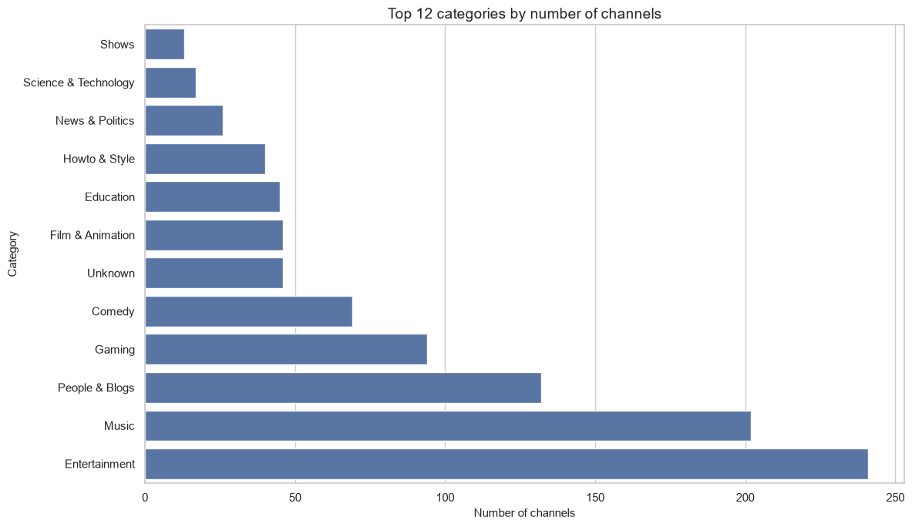
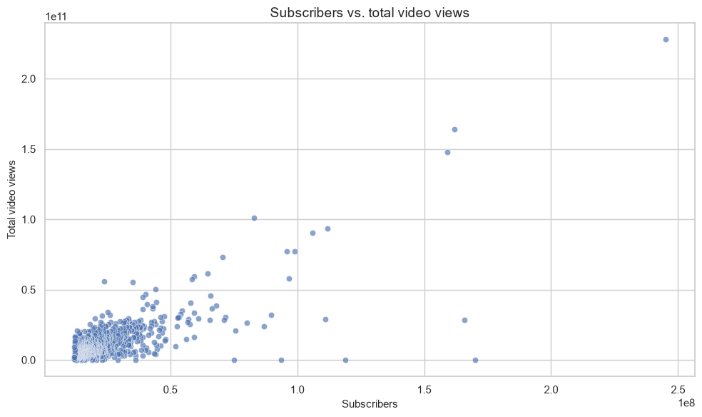
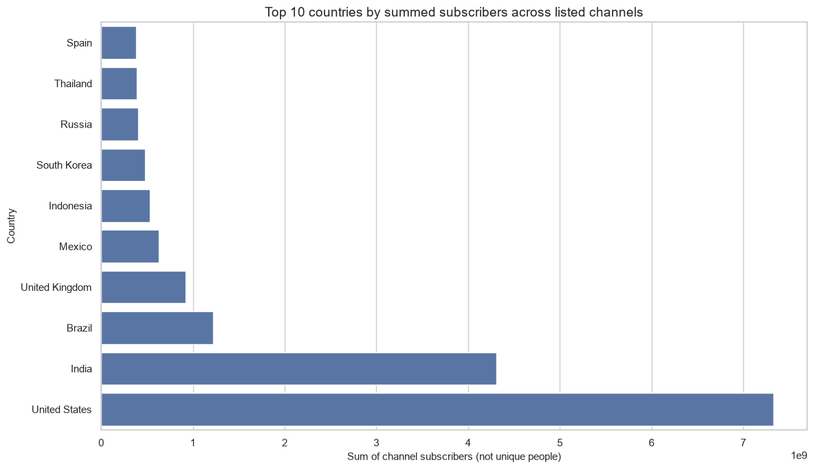
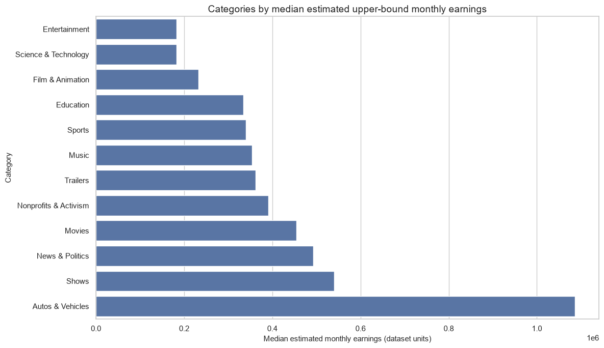

# Global YouTube Statistics — Exploratory Data Analysis

An exploratory data analysis project using Python to investigate channel categories, subscribers, video views, country representation, and estimated monthly earnings in a dataset of YouTube channels.

## Overview

The notebook focuses on descriptive questions and data quality rather than causal claims. It includes missing-value profiling, duplicate checks, summary tables, and visualizations that can be reproduced by running `main.ipynb`.

## Questions explored

- Which categories are most represented in the dataset?
- How are subscriber counts associated with total video views?
- Which countries have the largest sum of subscribers across the listed channels?
- How do estimated monthly earnings vary by category?
- How do subscriber counts differ by channel creation year?

## Visual results


### 1. Channel categories

Save screenshot as `images/category-counts.png`.



### 2. Subscribers vs. total video views

Save screenshot as `images/subscribers-vs-views.png`.



### 3. Countries represented in the dataset

Save screenshot as `images/country-subscribers.png`.



### 4. Estimated monthly earnings by category

Save screenshot as `images/earnings-by-category.png`.



> The image placeholders will display once you add the screenshot files to `images/` and commit them to GitHub.

## Dataset and data quality

- The notebook loads `Global YouTube Statistics.csv` from the project root.
- The analysis checks exact duplicate rows and counts/percentages of missing values.
- Missing values are not automatically converted to zero.
- Country totals represent the sum of subscribers across channels listed for each country; they do **not** represent unique people.
- `highest_monthly_earnings` is an estimated upper bound, not verified income.
- The dataset is a selected sample of channels, so results should not be generalized to all YouTube channels without further evidence.

**Dataset source:** add the original source URL and license here if you have them. Do not claim an unverified source.

## Tools

- Python
- pandas
- NumPy
- Matplotlib
- Seaborn
- Jupyter Notebook

## Run locally

### 1. Clone the repository

```bash
git clone https://github.com/Lelekndr/youtube_analysis.git
cd youtube_analysis
```

### 2. Create and activate a virtual environment

Windows PowerShell:

```powershell
python -m venv .venv
.\.venv\Scripts\Activate.ps1
```

If PowerShell blocks activation, you can use the environment's Python executable directly or follow your local execution policy guidance.

### 3. Install dependencies

```bash
python -m pip install --upgrade pip
python -m pip install pandas numpy matplotlib seaborn jupyter
```

### 4. Start Jupyter

```bash
jupyter notebook
```

Open `main.ipynb` and run the cells from top to bottom. Keep `Global YouTube Statistics.csv` in the same directory as the notebook.

## Project structure

```text
youtube_analysis/
├── Global YouTube Statistics.csv
├── main.ipynb
├── README.md
└── images/
    ├── category-counts.png
    ├── subscribers-vs-views.png
    ├── country-subscribers.png
    └── earnings-by-category.png
```

The `images/` files are screenshots to be added after running the notebook.

## Skills demonstrated

- Exploratory data analysis (EDA)
- Data quality checks and missing-value profiling
- Grouping and aggregation with pandas
- Correlation analysis
- Data visualization
- Careful interpretation of descriptive statistics and dataset limitations


